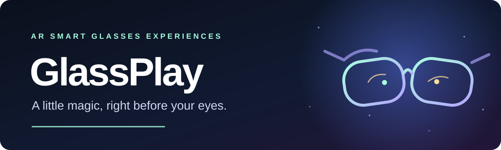
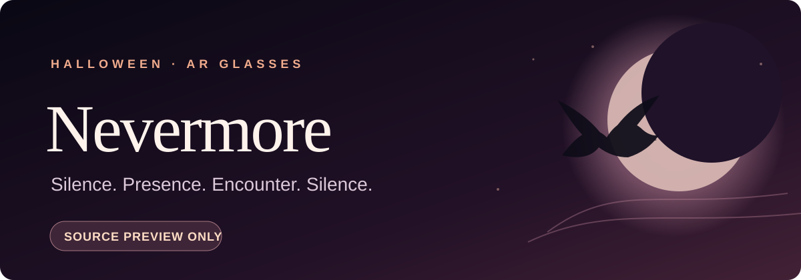

# GlassPlay
**A little magic, right before your eyes.**

Discover seasonal, interactive experiences created for **AR smart glasses**.

## Featured: Nevermore

### [Nevermore →](experiences/nevermore/README.md)
**Halloween comes looking for you.**

Meet the Midnight Host, choose Trick or Treat, hear the raven and discover 20 unexpected encounters.

**20 encounters** · **Offline voice** · **Instant DISARM**

**Release candidate:** `1.0.0-rc.1` passed Windows-host / Raven Simulator checks. The package is still a **private draft**, not a GlassPlay download. Physical Raven Prism remains **unverified**.

[Discover Nevermore](experiences/nevermore/README.md) · [Technical source preview](experiences/nevermore/app/README.md)

## Coming later

**Christmas · Easter · St. Patrick's Day**

*Planned experiences — not available to install.*

---

[Run the website](docs/DEVELOPMENT.md) · [Add an experience](docs/ADD_EXPERIENCE.md) · [Publication requirements](docs/DEPLOYMENT.md)

GlassPlay is an independent collection for **augmented-reality glasses**, not a VR store. Device support is verified per experience.

The Astro website is implemented for `/GlassPlay/`. It is not yet publicly deployed. The private review includes authentic approved Nevermore media; the default build uses original title artwork until media publication is authorized. [Implementation and validation](docs/IMPLEMENTATION.md).
