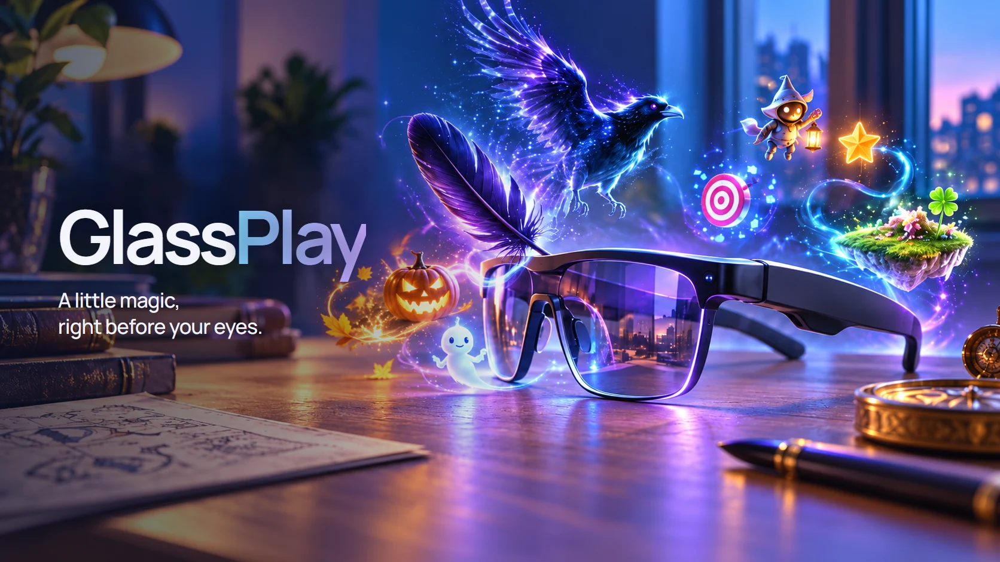

# GlassPlay
**A little magic, right before your eyes.**

Discover seasonal, interactive experiences created for **AR smart glasses**.

## Featured: Nevermore

### [Nevermore →](experiences/nevermore/README.md)
**Halloween comes looking for you.**

**Nevermore Halloween 1.1.0 — one application, two modes.** Walk through the Threshold into **SOFT** (magical Halloween: the Midnight Host, Trick or Treat and 20 encounters) or **HAUNTED** (a cinematic supernatural haunting).

**Two modes** · **Offline voice** · **Instant DISARM**

**[Download Nevermore Halloween 1.1.0](https://github.com/RBraga01/GlassPlay/releases/download/nevermore-v1.1.0/Nevermore-Halloween-1.1.0.zip)** (about 62 MB) · [Release notes and checksum](https://github.com/RBraga01/GlassPlay/releases/tag/nevermore-v1.1.0)
SHA-256 `f8b154d0cab073102b3604a01e297a6e4fe2134670f47739d5b3f937e6272937`

Verified on Windows with Raven Simulator and Raven Framework 1.0.6. Requires Python 3.10+ and Raven Framework, which is **not included**: obtain and use it separately under Raven Resonance's terms. Physical Raven Prism is **DEVICE-UNVERIFIED**; this is not an official Prism installation. Code MIT; Nevermore artwork and media All Rights Reserved.

[Nevermore on the website](https://rbraga01.github.io/GlassPlay/experiences/nevermore/) · [Install guide](docs/release/INSTALLATION.md) · [Archived 1.0.0-rc.2 source preview](experiences/nevermore/README.md)

## Coming later

**Christmas · Easter · St. Patrick's Day**

*Planned experiences — not available to install.*

---

[Run the website](docs/DEVELOPMENT.md) · [Add an experience](docs/ADD_EXPERIENCE.md) · [Publication requirements](docs/DEPLOYMENT.md)

GlassPlay is an independent collection for **augmented-reality glasses**, not a VR store. Device support is verified per experience.

Website: **https://rbraga01.github.io/GlassPlay/** — published from this repository with the owner-approved Nevermore images and videos. Rights: [NOTICE](NOTICE.md). [Implementation and validation](docs/IMPLEMENTATION.md).
