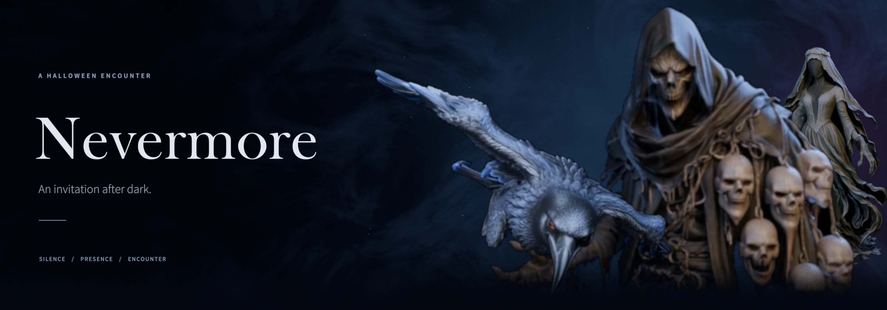

# Nevermore
**A Halloween haunting for AR smart glasses.**

*Silence → presence → encounter → silence.*

ARM the experience, meet the **Midnight Host** and choose **Trick or Treat**. Then return your attention to the world — and let the unexpected find you.

## What awaits

- **20 animated encounters** with sound and surprises.
- **Raven Sweep, Perch, Dive and Duet**, alongside ghosts, the spider and the Midnight Host.
- **Say “Raven”** to invite a raven. Voice recognition works **locally and offline**, only while armed and idle.
- **DISCOVERIES** remembers what you encountered. **DISARM** stops the experience immediately.

## How it works

`ARM` → `TRICK OR TREAT` → `SAY RAVEN` → `DISARM`

## Availability

**Windows / Raven Simulator release candidate: `1.0.0-rc.2`.** The curated ZIP (~55 MB), checksum, two demonstration videos and a Raven engineering handoff are prepared as a **private draft in the Nevermore development repository**. They have **not been released or copied into GlassPlay**.

**Verified:** Windows host and Raven Simulator 1.0.6; 20 authored encounters with audiovisual playback, offline “Raven” invocation, simulated sessions, DISARM/retrigger checks; package re-verified outside the development repository.
**Not verified:** physical Raven Prism hardware (**DEVICE-UNVERIFIED**), live-human speech accuracy on device.

**Licensing:** code MIT; Nevermore artwork and media All Rights Reserved; upstream CC0 and Apache-2.0 terms preserved. Raven Framework is not included or relicensed.

**You cannot install it from GlassPlay yet.** The public download waits for Raven's official third-party Framework/deployment process. The curated [Python source preview](app/README.md) and media manifests are available for review, without binaries or media.

[What remains](ASSETS_PENDING.md) · [← GlassPlay](../../README.md)
